

Website development evaluation · SEO audit

# Funngro Website SEO Audit Report

An audit of Funngro's Teen (<code>/earn</code>) and Company (<code>/about</code>) pages, the problems found, and the SEO improvements implemented in a two-page redesign.

<table class="cover-meta">
<tr><td>Audit date</td><td>27 November 2026</td></tr>
<tr><td>Site audited</td><td>https://www.funngro.com — <code>/earn</code> (Teen) and <code>/about</code> (Company)</td></tr>
<tr><td>Redesign (live, noindex)</td><td>https://funngro-revamp-evaluation.netlify.app/earn https://funngro-revamp-evaluation.netlify.app/about</td></tr>
<tr><td>Code &amp; documentation</td><td>https://github.com/The-enlit-dev/funggro-website-revamp Pull request: https://github.com/The-enlit-dev/funggro-website-revamp/pull/1</td></tr>
</table>

Independent student evaluation project. Funngro has not reviewed, approved or endorsed this audit or the redesign. All measurements were taken by the author with the tools named in each section; no search-ranking or traffic data was available.

## Contents
1. Executive summary
2. SEO fundamentals and why they matter for Funngro
3. Keyword research and search intent
4. On-page SEO: titles, descriptions and headings
5. Technical SEO: crawling, indexing, canonicals, sitemap and robots.txt
6. Image optimisation and alt text
7. Structured data and Schema.org
8. Mobile, page speed and Core Web Vitals
9. Off-page SEO
10. Audit findings — original Funngro website
11. Recommendations for funngro.com
12. Changes implemented in the redesign
13. Before-and-after comparison
14. Testing results
15. Limitations and items requiring Funngro's confirmation
16. Links
17. Sources and references

## 1. Executive summary

**What was audited.** The assignment's "Teen" page is `funngro.com/teen`, which redirects in the browser to `/earn` ("How it works"); the "Company" page is `/about`. Both were audited on 27 November 2026 with a headless browser, raw HTTP requests, Lighthouse and axe-core, and then redesigned as a static two-page site.

### Key findings on the original site

| # | Finding | Why it matters |
|---|---|---|
| 1 | Pages are rendered by JavaScript; the raw HTML is an empty shell with no headings, text or links | Crawlers that don't run JavaScript — and Google's first pass before rendering — see no content |
| 2 | `/teen` is not a real URL: it returns HTTP 200 with the homepage shell and relies on a JavaScript redirect | Duplicate content and a weak signal for the page the brief calls "Teen" |
| 3 | Unknown URLs return HTTP 200 instead of 404 ("soft 404s") | Search engines may index error pages |
| 4 | Canonical tags point to `https://funngro.com/…`, which redirects to `www` | The canonical names a URL that isn't the final one |
| 5 | Inner pages reuse the homepage's social-sharing tags; titles change after JavaScript runs | Wrong previews when shared; inconsistent signals |
| 6 | Copy repeats search phrases unnaturally; facts conflict across Funngro's own pages | Weakens trust for an audience that worries about scams |

### What the redesign changed (measured on the live evaluation site)

| Result | Original (`/earn`, mobile) | Redesign (`/earn`, mobile) |
|---|---|---|
| Content in raw HTML | None (empty shell) | Full page, works without JavaScript |
| Lighthouse Performance | 88 | **100** |
| Largest Contentful Paint (lab) | 3.4 s | **0.9 s** |
| Cumulative Layout Shift (desktop) | 0.181 | **0** |
| `/teen` response | 200 + homepage shell | **301 → /earn** |
| Unknown URL response | 200 (soft 404) | **404** |

The redesign scores **100** for Lighthouse Performance and Accessibility on both pages on mobile and desktop. Its SEO score on the evaluation site is **69 by design**, because that deployment is deliberately marked `noindex` (see §5.2). The same pages built for production score **100** in all four Lighthouse categories.

## 2. SEO fundamentals and why they matter for Funngro

### 2.1 What SEO is

Search engine optimisation (SEO) is the practice of making a website easy for search engines to **discover, understand and trust**, so that its pages appear for the searches its audience actually makes. Good SEO is not a trick applied after a site is built; it comes from clear content, sound technical foundations and genuine reputation.

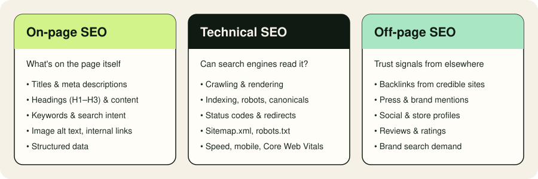

### 2.2 How search engines process a page

Search engines work in stages. A crawler fetches the HTML and follows links; a renderer may later run JavaScript; the indexer stores what it understood; ranking systems then match indexed pages to queries. Google documents that JavaScript pages are rendered in a later pass, and many other crawlers (social-media preview bots, some AI and search bots) don't run JavaScript at all. A page whose content only appears after rendering therefore depends on a step that may be delayed or skipped.

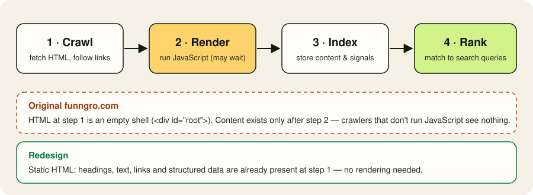

### 2.3 Why it matters for Funngro

- **The audience searches before it installs.** Funngro serves 14–25-year-olds (and their parents). Queries such as "earn money online as a teen in India" or "is Funngro safe" are moments where the website, not the app store, must answer.
- **Trust is the conversion barrier.** Funngro's own published stories repeatedly quote users who "thought earning apps were fake". Clear, consistent, crawlable information — company details, safety rules, real people — supports both SEO and trust.
- **Brand demand exists.** Funngro appeared on Shark Tank India Season 2 and has press coverage; people searching its name should land on accurate, well-structured pages.
- **The app is the goal.** SEO for Funngro means sending searchers to pages that explain the offer and link correctly to Google Play and the App Store.

## 3. Keyword research and search intent

**Search intent** is the reason behind a query. Matching the page to the intent matters more than repeating a phrase.

| Intent | Example queries (hypotheses) | Best page |
|---|---|---|
| Informational | earn money online as a teen in India · part-time work for students from home · how do brand tasks pay | Teen `/earn` |
| Commercial investigation | is Funngro safe · Funngro real or fake · Funngro review | Teen `/earn` (safety, FAQ) + Company `/about` |
| Navigational | Funngro · Funngro app · Funngro Shark Tank · Funngro founder | Company `/about`, homepage |
| Transactional | download Funngro · Funngro app download | Teen `/earn` (store badges, QR) |

**Method and limits.** No keyword tools, Search Console or traffic data were available, so the table lists *intent-based hypotheses* drawn from Funngro's own titles, its store listing and the audience analysis — not measured search volumes. Before launch they should be validated with Google Search Console (actual queries and impressions) and Google Keyword Planner.

**Applying it.** The Teen page targets the informational and transactional intents (title "Earn Money Online as a Teen in India — Funngro"); the Company page answers navigational and trust queries ("About Funngro — Our Mission, Founders & Story"). The original `/earn` copy repeated phrases such as "online work for earning" and "earning app without investment"; the redesign covers the same topics in natural language, because modern search systems understand meaning and because stuffed copy reads as spam to a sceptical audience.

## 4. On-page SEO: titles, descriptions and headings

| Element | Purpose | Good practice |
|---|---|---|
| `<title>` | Main signal of the page's topic; usually the clickable headline in results | Unique, descriptive, roughly 50–60 characters (Google truncates by pixel width), brand at the end |
| Meta description | Not a ranking factor, but often the snippet under the title — it affects click-through | Unique, ≈150–160 characters, a clear summary with the page's value |
| Headings (H1–H3) | Show structure to users, screen readers and search engines | One H1 that states the topic; H2/H3 in order, no skipped levels |

| Page | Original (rendered) | Redesign |
|---|---|---|
| `/earn` title | "Earn Money Online Through Online Jobs & Remote Work" — differs from the raw-HTML title "How to Earn Online as a Teen in India \| Funngro" | **Earn Money Online as a Teen in India — Funngro** (46 characters, same before and after JavaScript) |
| `/earn` H1 | "Start your online earning journey in five simple steps." (only after JavaScript) | **Earn your first income online, from real brands.** (in the HTML) |
| `/earn` description | Present after JavaScript; social tags still showed the homepage | 148 characters; per-page Open Graph/Twitter tags |
| `/about` title | "About Funngro — Built for India's Young Earners" (after JavaScript) | **About Funngro — Our Mission, Founders & Story** (45 characters) |
| `/about` H1 | "Built so young Indians can earn for real." (after JavaScript) | Same message, now in the HTML; one H1 |
| Heading order | Not checkable without JavaScript | Automated check: one H1 per page, no skipped levels |

Illustration only — how the redesigned title and description could appear in a results page (not a real search result)

funngro.com › earn

Earn Money Online as a Teen in India — Funngro

Do paid tasks for real brands — surveys, referrals, content and brand promotion. Free to join for ages 14–25. Withdraw what you earn to UPI or bank.

## 5. Technical SEO: crawling, indexing, canonicals, sitemap and robots.txt

### 5.1 Crawling and rendering

The single most important finding: the original pages are a client-side-rendered React app. The HTML a crawler receives for `/earn` is 4,232 bytes with an empty `
`, no H1, no visible text and no links. The redesign serves complete HTML.

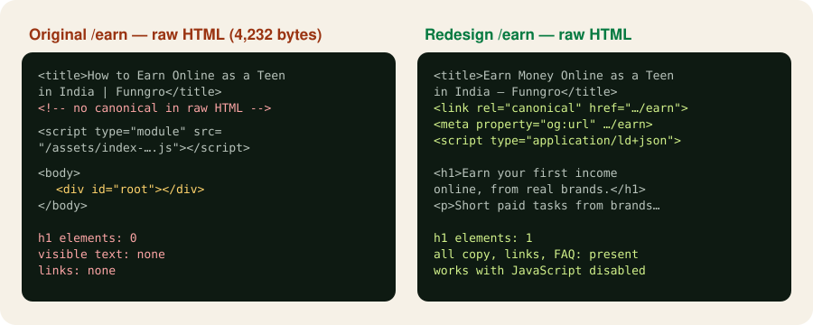

### 5.2 Indexing: robots meta, X-Robots-Tag and the evaluation site's noindex

- **`noindex`** (in `<meta name="robots">` or the `X-Robots-Tag` HTTP header) tells search engines not to show a page in results.
- **robots.txt** controls *crawling*, not indexing. If robots.txt blocks a page, crawlers can't read its `noindex`, and the URL can still be indexed (without content) if other sites link to it.

The redesign is hosted on an **evaluation URL that is intentionally `noindex, nofollow`** (meta tag and HTTP header), so it never competes with funngro.com or creates duplicate content. While preparing this report, the evaluation robots.txt was found to say `Disallow: /`, which would have hidden that `noindex` from crawlers; it was corrected to `Allow: /` and redeployed. The production build removes all `noindex` signals.

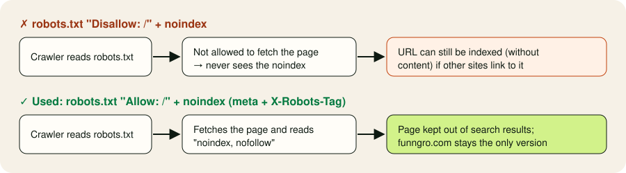

### 5.3 Canonical URLs

A canonical URL (`<link rel="canonical">`) tells search engines which address is the preferred version when several URLs show the same content. It is a strong hint, and it should name the *final* URL. The original site's canonicals point to `https://funngro.com/…`, which 301-redirects to `https://www.funngro.com/…` — the canonical names a redirecting URL, while the sitemap uses `www`. The redesign uses an absolute, self-referencing canonical generated from one setting: the evaluation URL on the evaluation site, `https://www.funngro.com/earn` and `/about` in the production build.

### 5.4 Status codes and redirects

| Code | Meaning | Correct use |
|---|---|---|
| 200 | OK | A real page |
| 301 | Moved permanently | Old or duplicate URLs → passes signals to the new URL |
| 302 | Moved temporarily | Short-term redirects |
| 404 | Not found | URLs that don't exist — a "soft 404" (200 for an error page) wastes crawling and can get error pages indexed |

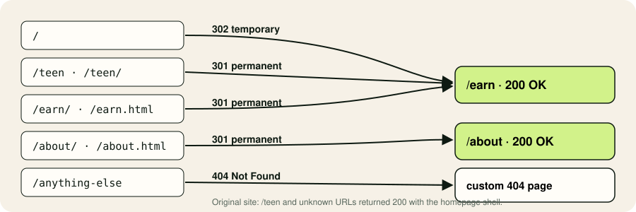

### 5.5 Sitemap.xml and robots.txt

A **sitemap.xml** lists the URLs a site wants indexed (with last-modified dates); **robots.txt** tells crawlers what they may fetch and where the sitemap is. The original site's robots.txt and 40-URL sitemap are valid, but the sitemap omits `/teen` (correctly, since it isn't a real page) while the site still serves it with a 200. The redesign's sitemap validates against the official sitemaps.org XML schema; the production robots.txt allows crawling and references the sitemap, while the evaluation robots.txt allows crawling without advertising a sitemap.

## 6. Image optimisation and alt text
Images affect SEO through **alt text** (describes the image for screen readers and image search), **file size** (affects loading speed) and **dimensions** (declared width/height prevent layout shift).

| Practice | Redesign implementation |
|---|---|
| Descriptive alt text; empty alt for decorative images | Every `` has `alt` (e.g. "Funngro wallet screen with balance and withdraw button"); decorative copies use `alt=""` |
| Modern formats | AVIF → WebP → JPEG via `<picture>`, sizes 200–1280 px with `srcset` |
| Declared dimensions | `width`/`height` on every image (automated check) |
| Prioritise the hero, lazy-load the rest | Hero image `fetchpriority="high"`; others `loading="lazy"` |
| Social preview images | One 1200×630 Open Graph image per page (verified: HTTP 200, image/jpeg, 1200×630) |
The original `/earn` page had **no images at all**, which is a missed opportunity for both engagement and image search.

## 7. Structured data and Schema.org
Structured data is machine-readable information (usually JSON-LD using the Schema.org vocabulary) that tells search engines exactly what a page describes — an organisation, an app, a breadcrumb trail, an FAQ. It can make pages eligible for rich results, but it must describe content that is actually visible on the page.

| Page | Original | Redesign |
|---|---|---|
| `/earn` | Organization and WebSite repeated (shell + per-route); BreadcrumbList; FAQPage | One graph: WebPage, WebSite, Organization, MobileApplication (free; no rating claims), BreadcrumbList, FAQPage generated from the visible FAQ |
| `/about` | Organization with legal name "Funngro Innovations Pvt Ltd" (store listings and footer say Wishbanc Technologies Private Limited); logo pointing to the social image | AboutPage; Organization with `legalName` Wishbanc Technologies Private Limited, a square logo, `foundingDate` 2021, verified founders (Person, `jobTitle`, LinkedIn `sameAs`) |
| Validation | — | **validator.schema.org: 0 errors on both pages** |

Google restricted FAQ rich results to a small set of authoritative sites in 2023, so the FAQPage markup is kept for clarity, not expected to produce a rich snippet.

## 8. Mobile, page speed and Core Web Vitals
Google uses mobile-first indexing, and page experience — including **Core Web Vitals** — is part of how it evaluates pages.

| Metric | Measures | "Good" threshold |
|---|---|---|
| LCP — Largest Contentful Paint | Loading: when the main content appears | ≤ 2.5 s |
| INP — Interaction to Next Paint | Responsiveness to taps and clicks (replaced FID in 2024) | ≤ 200 ms |
| CLS — Cumulative Layout Shift | Visual stability | ≤ 0.1 |

| | Original `/earn` | Redesign `/earn` |
|---|---|---|
| Mobile LCP (lab) | 3.4 s | **0.9 s** |
| Desktop CLS (lab) | 0.181 | **0** |
| Interaction latency | — | max **32 ms** (lab Event Timing during taps) |
| Mobile layout | Usable but very long (≈13 phone screens on `/earn`) | Tested at 7 widths (320–1440 px): no horizontal overflow |

All figures are lab measurements; neither site had real-user (field) data available for these pages. Speed in the redesign comes from static HTML, ≈4 KB of JavaScript, two subset web fonts (≈82 KB total, preloaded, `font-display: swap`), responsive AVIF/WebP images, Brotli compression and long-term caching of hashed assets.

## 9. Off-page SEO
Off-page SEO covers the signals a site earns elsewhere: backlinks from credible sites, press and brand mentions, social and app-store profiles, reviews and brand search demand.

**Observed (not measured):** Funngro has coverage in Entrackr, The Daily Brunch, IBS Intelligence, Business News Week, FM Live and a Times of India blog; it appeared on Shark Tank India Season 2; it has Google Play and App Store listings (Google Play: 4.1★ from 54.6K reviews, 50L+ downloads on 27 Nov 2026) and social profiles linked from its site. No backlink or brand-search data was available, so this audit makes no claims about link authority.

**Recommendations:** keep the company name, legal entity and key facts identical across the website, store listings and press kit (they currently conflict); link the official social profiles consistently (two different Instagram handles are in circulation); ask publishers covering Funngro to link to the relevant page (e.g. `/about` for company stories); and monitor brand queries in Search Console.

## 10. Audit findings — original Funngro website
*Scope: funngro.com `/earn` and `/about` (plus the homepage for context) on 27 November 2026. Tools: curl, Playwright, Lighthouse (single lab runs), axe-core.*

<figure>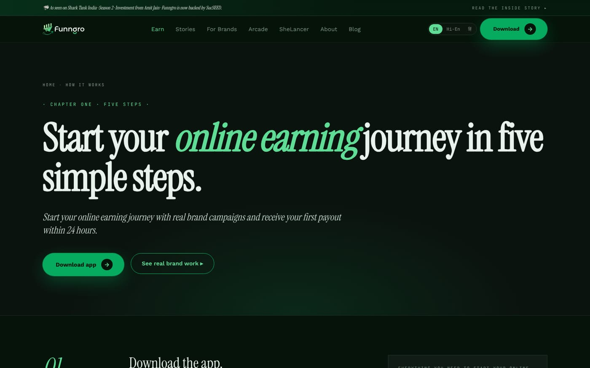<figcaption>Original <code>/earn</code> (desktop)</figcaption></figure>
<figure>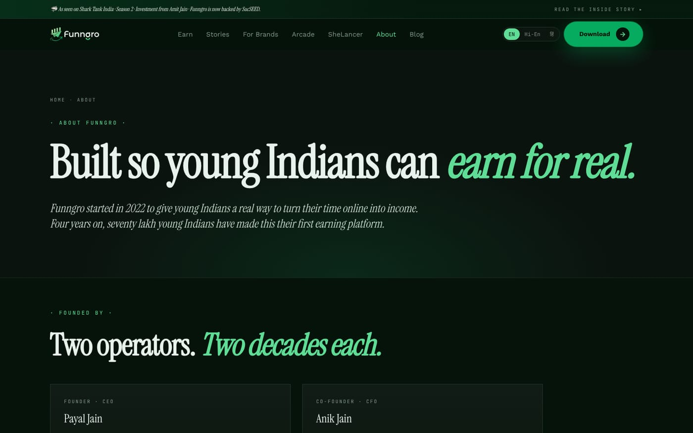<figcaption>Original <code>/about</code> (desktop)</figcaption></figure>

| # | Finding | Evidence | Severity |
|---|---|---|---|
| O1 | Client-side rendering — empty HTML shell | Raw `/earn` = 4,232 bytes, `
`, 0 H1 | High |
| O2 | `/teen` returns 200 + homepage shell; JavaScript redirect only | curl: HTTP 200, homepage title | High |
| O3 | Soft 404s | `/nonexistent-page-xyz` → HTTP 200 | High |
| O4 | Canonical points to a redirecting host | canonical `https://funngro.com/earn`; that URL 301s to `www` | High |
| O5 | Inner pages reuse homepage social tags | `/earn` og:url = `https://funngro.com/` | Medium |
| O6 | Title differs before/after JavaScript | raw vs rendered titles (§4) | Medium |
| O7 | Structured data inconsistent and duplicated | legalName mismatch; Organization/WebSite repeated | Medium |
| O8 | Keyword-stuffed copy; H1 lacks the audience term | page text | Medium |
| O9 | Mobile LCP 3.4 s (`/earn`), desktop CLS 0.181 | Lighthouse | Medium |
| O10 | Obsolete `keywords` meta; trailing-slash duplicates | raw HTML; `/about/` → 200 | Low |
| O11 | Accessibility: low-contrast text, buttons whose accessible names don't match their visible text | axe-core (`color-contrast`, `label-content-name-mismatch`) | Medium |
| O12 | Conflicting facts (founder titles, founding year, user counts, payout and fee claims) | Funngro's About vs Press pages, FAQ, store listing | Medium (trust) |
| ✓ | Positives: valid robots.txt and sitemap, HTTPS + HSTS, apex→www 301, `lang="en-IN"` | curl | — |

### Original Lighthouse scores (lab, single run, 27 Nov 2026)

| Page | Device | Performance | Accessibility | Best Practices | SEO | LCP | CLS |
|---|---|---|---|---|---|---|---|
| `/earn` | Mobile | 88 | 100 | 100 | 100 | 3.4 s | 0 |
| `/earn` | Desktop | 91 | 96 | 100 | 100 | 0.9 s | 0.181 |
| `/about` | Mobile | 91 | 100 | 100 | 100 | 2.9 s | 0.025 |
| `/about` | Desktop | 99 | 100 | 100 | 100 | 0.9 s | 0.038 |

The original site's Lighthouse SEO score of 100 illustrates an important point: Lighthouse only checks basics (a title exists, links are crawlable in the rendered page, no `noindex`). It does not detect an empty HTML shell, soft 404s or a canonical pointing to a redirect — those require manual technical auditing.

## 11. Recommendations for funngro.com
| Priority | Recommendation | Fixes |
|---|---|---|
| 1 | Serve real HTML: pre-render or server-render the React routes (or move key pages to static HTML) | O1, O6 |
| 2 | Make `/teen` a server-side 301 to `/earn` | O2 |
| 3 | Return HTTP 404 for unknown routes | O3 |
| 4 | Point canonicals to the final `https://www.funngro.com/…` URLs | O4 |
| 5 | Generate per-page title, description and Open Graph tags in the HTML | O5, O6 |
| 6 | One consistent JSON-LD graph per page with the correct legal name and a square logo | O7 |
| 7 | Rewrite copy for people; one clear H1 per page | O8 |
| 8 | Optimise LCP and layout stability (image dimensions, font loading) | O9 |
| 9 | Align facts across site, store listings and press kit | O12 |
| 10 | Fix contrast and label mismatches; remove the keywords meta | O10, O11 |

## 12. Changes implemented in the redesign
The redesign is a static two-page site (HTML, CSS and about 4 KB of vanilla JavaScript) hosted on Netlify. It implements recommendations 1–10 for its two pages.

<figure>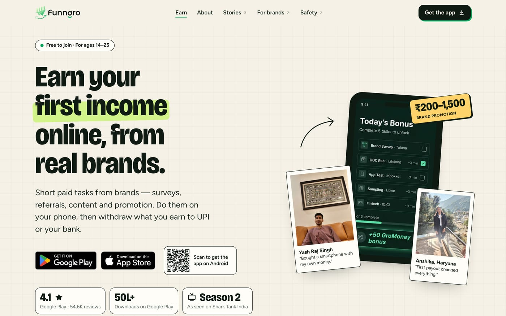<figcaption>Redesigned Teen page <code>/earn</code> (desktop, live)</figcaption></figure>
<figure>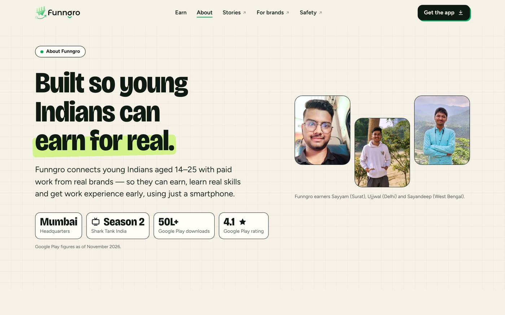<figcaption>Redesigned Company page <code>/about</code> (desktop, live)</figcaption></figure>

<figure>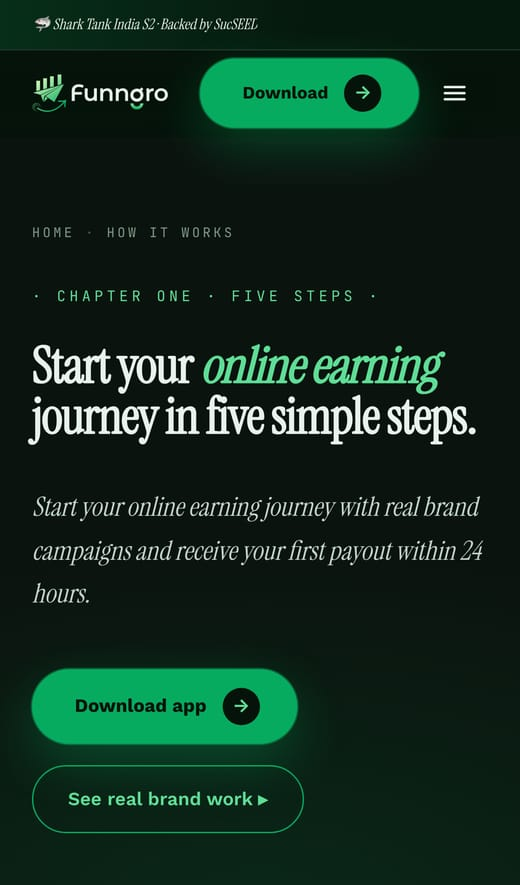<figcaption>Original <code>/earn</code> (mobile)</figcaption></figure>
<figure>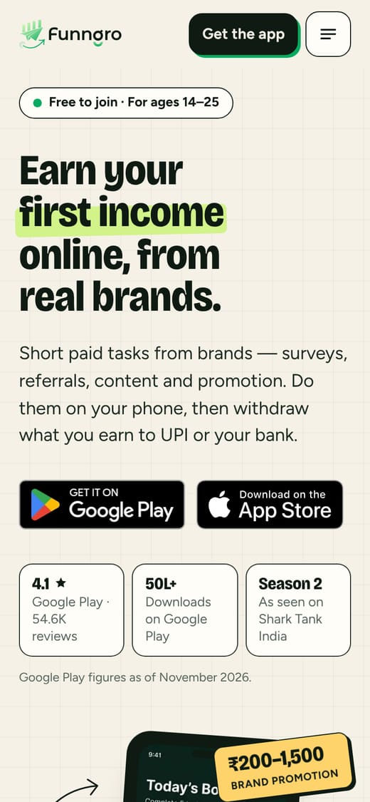<figcaption>Redesign <code>/earn</code> (mobile)</figcaption></figure>
<figure>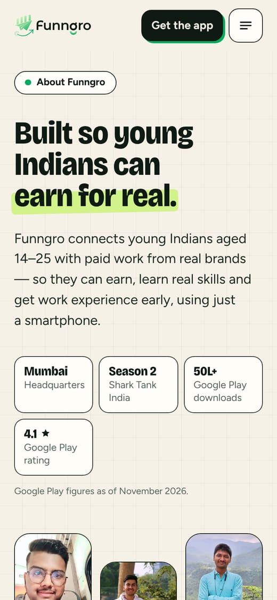<figcaption>Redesign <code>/about</code> (mobile)</figcaption></figure>

| Area | Implemented |
|---|---|
| Rendering | Static HTML; all content, links, FAQ and JSON-LD in the server response; both pages fully usable with JavaScript disabled |
| URLs | `/earn` and `/about` (kept from the live site); `/teen` → 301; `/earn/`, `/earn.html` etc. → 301; `/` → `/earn` (302 on the evaluation site); real 404 page |
| Metadata | Unique titles (45–46 characters) and descriptions (148–149); self-referencing canonicals; per-page Open Graph/Twitter tags and 1200×630 images |
| Headings & content | One H1 per page, ordered H2/H3; natural copy; facts limited to independently verified or consistently published information, with unresolved items shown as "To be confirmed" |
| Structured data | One validated JSON-LD graph per page (see §7) |
| Images | AVIF/WebP/JPEG with `srcset`, alt text, dimensions, lazy loading |
| Performance | ≈4 KB JS, subset fonts, Brotli, immutable caching, no third-party scripts |
| Accessibility | WCAG 2.2 AA colour contrast, visible focus, skip link, keyboard-operable menu and carousel |
| Indexing control | `DEPLOY_TARGET` switch: evaluation = `noindex` (meta + header, crawling allowed); production = indexable with sitemap |
| Trust content | Verified company facts, safety rules, a "For parents" card, and a researched founder section (titles and backgrounds checked against independent sources; each founder links to their own LinkedIn profile) |

<figure class="wide">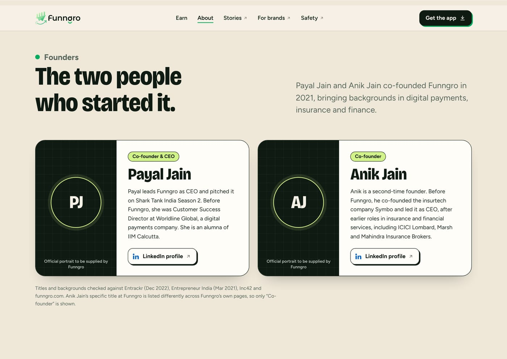<figcaption>Company page founder section — titles and backgrounds verified against Entrackr, Inc42, Entrepreneur India and funngro.com; portraits await official photos from Funngro</figcaption></figure>

## 13. Before-and-after comparison
| Check | Original funngro.com | Redesign |
|---|---|---|
| Content in raw HTML | ✗ Empty shell | ✓ Complete |
| H1 in raw HTML | ✗ 0 | ✓ 1 per page |
| `/teen` | ✗ 200 + homepage shell | ✓ 301 → `/earn` |
| Unknown URLs | ✗ 200 (soft 404) | ✓ 404 |
| Canonical | ✗ Redirecting host | ✓ Final URL |
| Social tags on `/earn` | ✗ Homepage's | ✓ Page-specific |
| Title stable before/after JS | ✗ Changes | ✓ Identical |
| Structured data | ✗ Duplicated, wrong legal name | ✓ One graph, 0 validator errors |
| Images on `/earn` | ✗ None | ✓ Optimised photos and app screens with alt text |
| Lighthouse Performance, `/earn` mobile | 88 | **100** |
| LCP, `/earn` mobile | 3.4 s | **0.9 s** |
| CLS, `/earn` desktop | 0.181 | **0** |
| Lighthouse Accessibility, `/earn` desktop | 96 | **100** |
| axe-core violations (desktop) | `/earn`: label-content-name-mismatch · `/about`: color-contrast | **0** on both pages |

## 14. Testing results
*Live evaluation site, final run 27 November 2026 (04:54–05:00 UTC); production build served locally the same day. Lighthouse: median of 3 runs, lab data.*

<figure><figcaption>Lighthouse, live evaluation site — <code>/earn</code> mobile (SEO 69 because of the intentional noindex)</figcaption></figure>
<figure><figcaption>Lighthouse, production build — <code>/earn</code> mobile</figcaption></figure>

| Page | Device | Live evaluation site (Perf / A11y / BP / SEO) | Production build (Perf / A11y / BP / SEO) |
|---|---|---|---|
| `/earn` | Mobile | **100 / 100** / 92* / 69† | **100 / 100 / 100 / 100** |
| `/earn` | Desktop | **100 / 100** / 92* / 69† | **100 / 100 / 100 / 100** |
| `/about` | Mobile | **100 / 100** / 92* / 69† | **100 / 100 / 100 / 100** |
| `/about` | Desktop | **100 / 100** / 92* / 69† | **100 / 100 / 100 / 100** |

\* Best Practices 92: console errors caused by Netlify's free-plan badge script, which the site's Content-Security-Policy blocks. † SEO 69: "page is blocked from indexing" — the intended `noindex` on the evaluation site.

| Test area | Tool | Result |
|---|---|---|
| Accessibility (WCAG 2.0/2.1/2.2 A + AA) | axe-core — both pages + 404, mobile and desktop, menu open | **0 violations** |
| Keyboard navigation and focus | Playwright script | **15/15** |
| Responsive layout | Playwright at 320, 360, 390, 768, 1024, 1280, 1440 px | No overflow; 0 console errors from site code |
| Interactions and no-JavaScript rendering | Playwright | **26/26** |
| Links, buttons, QR code, store links | Playwright + fetch | **26/26**; QR decodes to the Google Play listing |
| SEO metadata (titles, descriptions, canonical, OG, H1, alt, server-rendered content) | Playwright script | **All pass** |
| Structured data | validator.schema.org | **0 errors** |
| Sitemap | sitemaps.org XML schema | **Valid** |
| HTML | W3C Nu validator | **0 errors** |
| Delivery (compression, caching, fonts, robots, noindex header) | Node script | **27/27** |
| Redirects and 404 | curl | As in §5.4 |

## 15. Limitations and items requiring Funngro's confirmation
### Limitations of this audit

- No Google Search Console, ranking, traffic, keyword-volume or backlink data — keyword targets are hypotheses and no ranking claims are made.
- Lighthouse figures are lab measurements from a cloud environment; no real-user Core Web Vitals exist for these pages.
- Not tested on physical devices or with screen readers; Google's Rich Results Test (a manual tool) was not run — validator.schema.org was used instead.
- Four external links (LinkedIn ×3, IBS Intelligence) block automated checking.
- The redesign covers two pages; site-wide issues on funngro.com (other routes, the live host's canonicals) are outside its reach.

### Items requiring Funngro's confirmation before any production use

| Item | Current handling |
|---|---|
| Official founder portraits | Labelled placeholders |
| Anik Jain's official LinkedIn and title | Independently corroborated profile used; shown as "Co-founder" |
| Parental-consent wording (14–25 vs App Store 16+) | "To be confirmed" |
| SucSEED Indovation relationship | "To be confirmed" |
| Consent to reuse published earner stories and photos | Used as published on funngro.com, attributed |
| Preferred app link for the QR code | Google Play listing |
| Official Instagram handle | Not linked |
| Payout timing and fee wording | Neutral wording; no contradictory claims |

## 16. Links
| | |
|---|---|
| Redesigned Teen page (live, noindex) | https://funngro-revamp-evaluation.netlify.app/earn |
| Redesigned Company page (live, noindex) | https://funngro-revamp-evaluation.netlify.app/about |
| GitHub repository | https://github.com/The-enlit-dev/funggro-website-revamp |
| Pull request (all work; not merged) | https://github.com/The-enlit-dev/funggro-website-revamp/pull/1 |
| Delivery package | https://github.com/The-enlit-dev/funggro-website-revamp/tree/ccr-96f21ab3-2ydwkw/delivery |
| Original site audited | https://www.funngro.com/earn · https://www.funngro.com/about |

## 17. Sources and references
### Search engine documentation

1. Google Search Central — SEO Starter Guide: https://developers.google.com/search/docs/fundamentals/seo-starter-guide
2. Google — Understand JavaScript SEO basics: https://developers.google.com/search/docs/crawling-indexing/javascript/javascript-seo-basics
3. Google — Consolidate duplicate URLs (canonicalization): https://developers.google.com/search/docs/crawling-indexing/consolidate-duplicate-urls
4. Google — Robots meta tag and X-Robots-Tag: https://developers.google.com/search/docs/crawling-indexing/robots-meta-tag
5. Google — Introduction to robots.txt: https://developers.google.com/search/docs/crawling-indexing/robots/intro
6. Google — Sitemaps overview: https://developers.google.com/search/docs/crawling-indexing/sitemaps/overview
7. Google — Title links: https://developers.google.com/search/docs/appearance/title-link
8. Google — Snippets and meta descriptions: https://developers.google.com/search/docs/appearance/snippet
9. Google — Image SEO best practices: https://developers.google.com/search/docs/appearance/google-images
10. Google — Introduction to structured data: https://developers.google.com/search/docs/appearance/structured-data/intro-structured-data
11. Google Search Central Blog — Changes to HowTo and FAQ rich results (2023): https://developers.google.com/search/blog/2023/08/howto-faq-changes
12. Google — HTTP status codes and soft 404s: https://developers.google.com/search/docs/crawling-indexing/http-network-errors
13. web.dev — Web Vitals: https://web.dev/articles/vitals
14. Chrome for Developers — Lighthouse overview: https://developer.chrome.com/docs/lighthouse/overview
15. Schema.org: https://schema.org/
16. Sitemaps protocol: https://www.sitemaps.org/protocol.html
17. W3C — Web Content Accessibility Guidelines (WCAG) 2.2: https://www.w3.org/TR/WCAG22/

### Funngro facts (full register in the repository: `research/06-verified-facts.md`)

18. Funngro website (About, Press, FAQ, Trust pages): https://www.funngro.com
19. Funngro on Google Play: https://play.google.com/store/apps/details?id=com.wishbanc.funngro
20. Entrackr (15 Dec 2022): https://entrackr.com/2022/12/funngro-helps-teens-with-essential-financial-education-valuable-work-experience/
21. Inc42 — Payal Jain profile: https://inc42.com/person/payal-jain-8780191/
22. Venture Intelligence — Shark Tank investment (₹50 lakh from Amit Jain and Namita Thapar): https://news.ventureintelligence.com/private-equity/freelancing-enabler-for-teens-funngro-raises-rs.50-l-from-amit-jain%2C-namita-thapar
23. Outlook Startup — same investment (did not respond during link verification on 27 Nov 2026): https://startup.outlookindia.com/investors/funngro-raises-rs-50-lakh-from-namita-thapar-and-amit-jain-news-7704
24. Entrepreneur India (4 Mar 2021): https://www.entrepreneur.com/en-in/finance/insurtech-startup-symbo-platform-raises-94-mn-in-series-a/366530

### Project evidence (repository)

`research/05-seo-audit-preliminary.md` (original-site audit) · `qa/REDESIGN-SEO-AUDIT.md` · `qa/QA-REPORT.md` · `qa/final-run-2026-11-27.log` · `qa/lighthouse/` · `qa/schema-validator.json`
