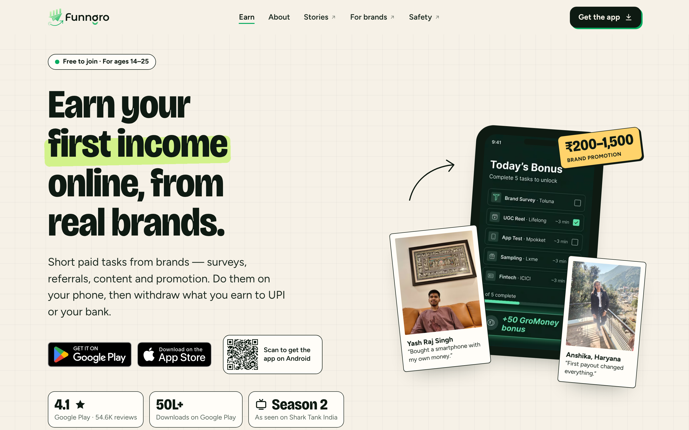
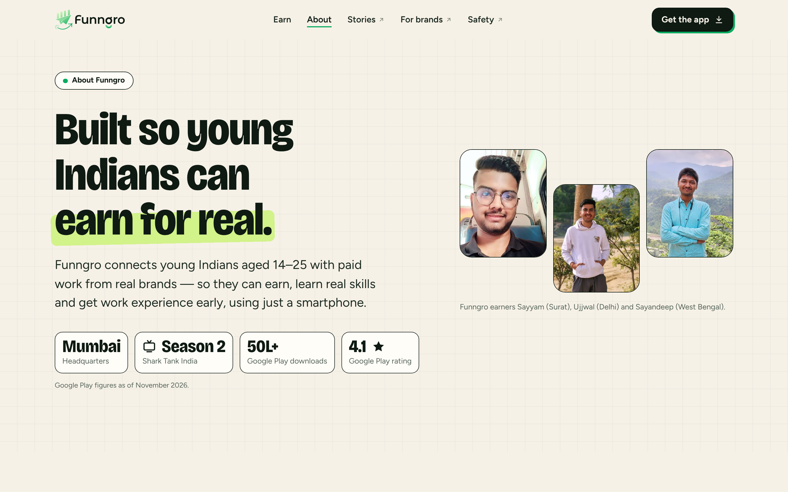
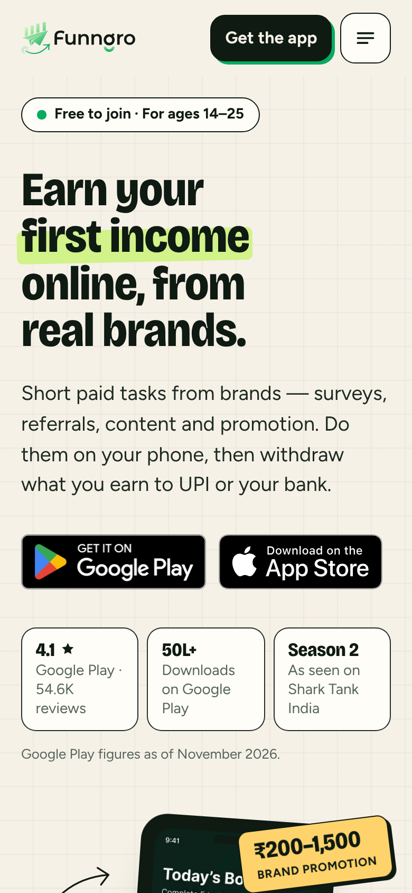
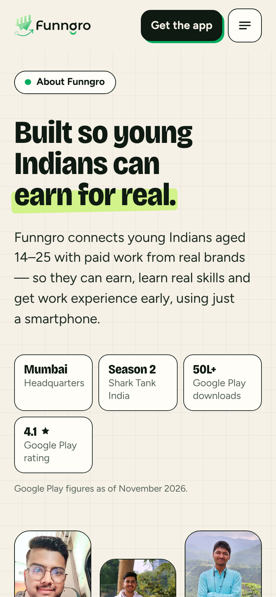

# Funngro redesign — delivery package

Two-page redesign of **Funngro**'s Teen page (`/earn`) and Company page (`/about`), built for a website-development evaluation.

## Links
| | |
|---|---|
| **Live — Teen page** | https://funngro-revamp-evaluation.netlify.app/earn |
| **Live — Company page** | https://funngro-revamp-evaluation.netlify.app/about |
| Live root | https://funngro-revamp-evaluation.netlify.app (redirects to `/earn`) |
| **GitHub repository** | https://github.com/The-enlit-dev/funggro-website-revamp |
| **Pull request** (all work; draft, not merged) | https://github.com/The-enlit-dev/funggro-website-revamp/pull/1 |
| Branch with the code | https://github.com/The-enlit-dev/funggro-website-revamp/tree/ccr-96f21ab3-2ydwkw |

> The evaluation site is deliberately **`noindex`** so it never competes with funngro.com in search. Nothing has been published on Funngro's official domain.
> Until the pull request is merged, the repository's `main` branch only contains the initial README — review the code via the PR or the branch link.

## Read in this order
| # | Document | What's in it |
|---|---|---|
| 1 | [Project overview](01-project-overview.md) | Brief, research, strategy, design decisions, implementation, results |
| 2 | [Phase completion review](02-phase-completion.md) | Each brief phase mapped to evidence; what wasn't possible |
| 3 | [Original website — SEO audit](03-original-site-seo-audit.md) | Funngro's current site only |
| 4 | [Redesign — SEO audit](04-redesign-seo-audit.md) | The two new pages only |
| 5 | [QA & accessibility report](05-qa-accessibility-report.md) | Every test, tool and result |
| 6 | [Lighthouse & performance](06-performance-lighthouse.md) | Scores, Core Web Vitals, weights, before/after |
| 7 | [Facts, questions & assumptions](07-facts-questions-assumptions.md) | What's verified, what's open, what was assumed |
| 8 | [Items for Funngro to confirm](08-funngro-confirmation-items.md) | Everything outstanding that only Funngro can supply |
| 9 | [Deployment & pre-production checklist](09-deployment-and-preproduction.md) | How to build, test and (with approval) go live |
| 10 | [Submission summary](10-submission-summary.md) | Short, ready-to-paste project summary |

## Screenshots (captured from the live evaluation site, 27 Nov 2026)
| Page | Desktop 1440 px | Tablet 768 px | Mobile 390 px |
|---|---|---|---|
| Teen `/earn` | [first screen](screenshots/earn-desktop-1440-fold.png) · [full page](screenshots/earn-desktop-1440-full.png) | [full page](screenshots/earn-tablet-768-full.png) | [first screen](screenshots/earn-mobile-390-fold.png) · [full page](screenshots/earn-mobile-390-full.png) |
| Company `/about` | [first screen](screenshots/about-desktop-1440-fold.png) · [full page](screenshots/about-desktop-1440-full.png) | [full page](screenshots/about-tablet-768-full.png) | [first screen](screenshots/about-mobile-390-fold.png) · [full page](screenshots/about-mobile-390-full.png) |
| Founders section | [desktop](screenshots/about-founders-desktop-1440.png) | — | [mobile](screenshots/about-founders-mobile-390.png) |

## Where everything else lives
`research/` (Phase 1 evidence) · `strategy/` · `design/` (concept boards, design system, implementation spec) · `src/` (site source) · `tests/` (QA scripts) · `qa/` (full QA report, redesign SEO audit, raw results) · `PROJECT_STATUS.md` · `DEPLOYMENT.md`.
